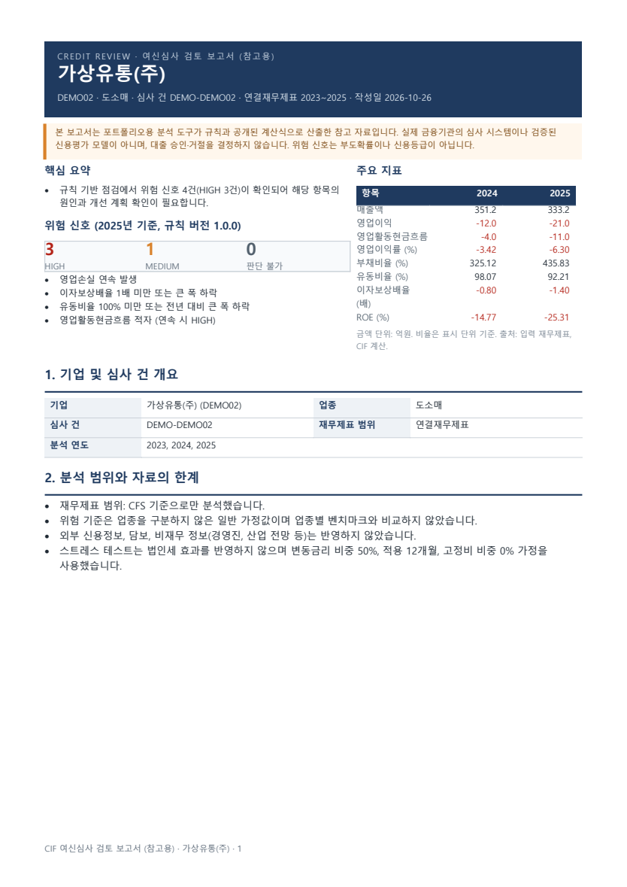
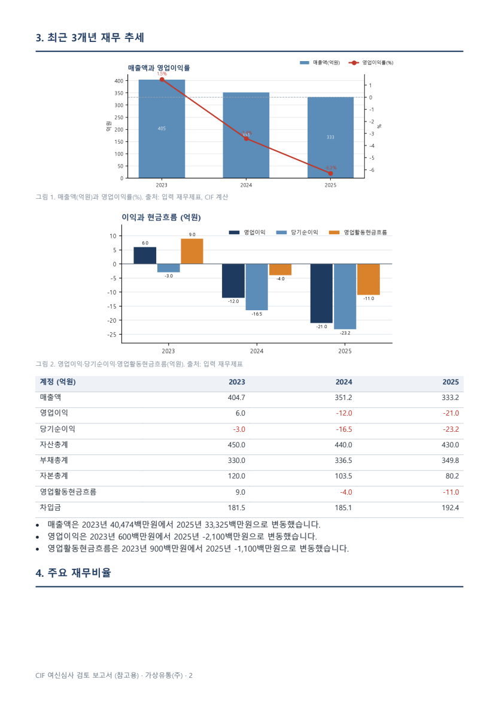
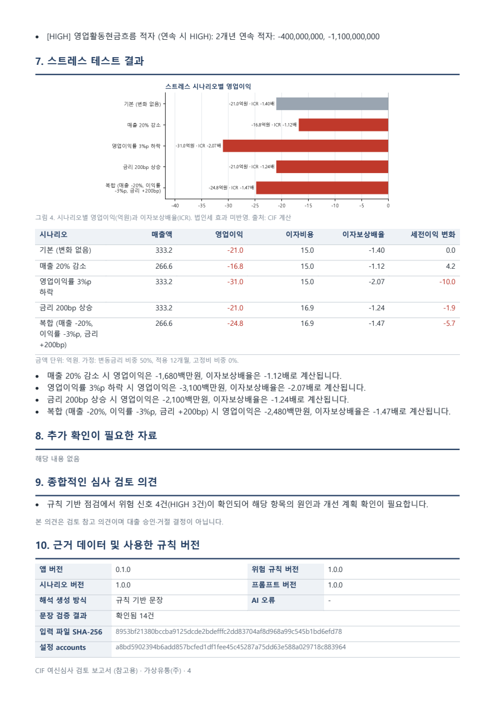
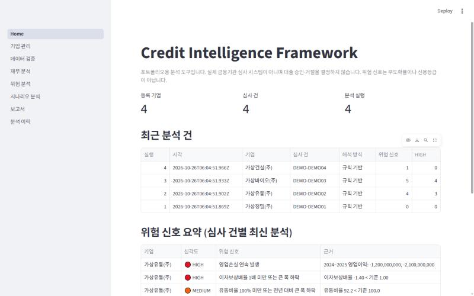
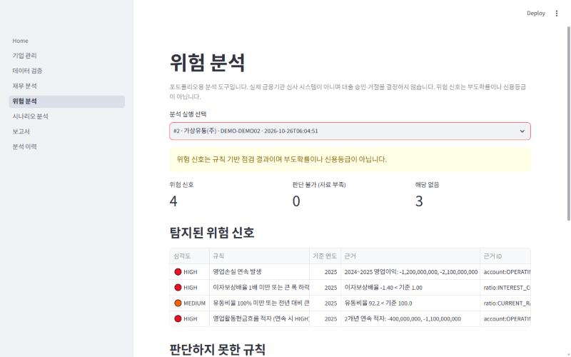
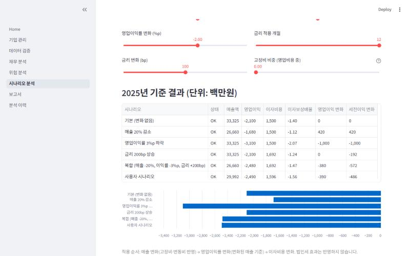

# Credit Intelligence Framework (CIF)

기업 재무제표를 검증하고, 재무비율과 규칙 기반 위험 신호·스트레스 테스트를 계산한 뒤,
**검증된 수치만 근거로** AI가 여신심사 검토 보고서를 작성하는 개인 PC용 분석 도구입니다.

> **포트폴리오용 프로젝트입니다.** 실제 금융기관의 심사 시스템이나 검증된 신용평가 모델이 아니며,
> 대출 승인·거절을 결정하지 않습니다. 위험 신호는 부도확률이나 신용등급이 아닙니다.
> 시연 데이터는 모두 가상 기업입니다.

## 미리보기

**여신심사 검토 보고서 (PDF, 가상 기업 DEMO02 · 영업손실 지속 시나리오)**

| 요약 · 주요 지표 · 위험 신호 | 재무 추세 차트 | 위험 신호 · 스트레스 테스트 |
|---|---|---|
|  |  |  |

**Streamlit 대시보드**

| 홈 | 위험 분석 | 시나리오 분석 |
|---|---|---|
|  |  |  |

AI 해석은 실제 Claude API(`claude-opus-5-5`)로도 확인했습니다. 한 번의 실행에서 AI가 쓴 45문장 중 44문장이 근거 검증을 통과했고,
1문장은 인용하지 않은 연도의 값을 써서 "수치 불일치"로 표시되었습니다. 같은 실행에서 AI가 시연 데이터의 자본 변동–순이익 불일치를 지적해 데이터 생성기를 고쳤습니다.
(위 이미지는 API 키 없이 동작하는 규칙 기반 해석 버전입니다.)

## 핵심 설계

| 원칙 | 구현 |
|---|---|
| 계산과 AI 해석 분리 | 모든 수치는 Python 코드가 계산 (`analysis/`). AI는 근거 패키지에 대한 해석 문장만 작성 |
| 근거 없는 주장 금지 | AI 문장마다 근거 ID 인용 필수. 본문 숫자가 인용 근거와 맞지 않으면 "수치 불일치"로 표시하고 사실로 쓰지 않음 |
| 자동 결정 금지 | 보고서 스키마에 승인·거절 필드 없음. "대출을 승인합니다" 같은 표현은 정책 위반으로 차단 |
| 재현성 | 입력 파일·설정 파일 SHA-256, 앱·규칙·프롬프트 버전을 분석마다 기록. 같은 입력·규칙이면 같은 결과 |
| 이력 보존 | 분석 결과·감사 로그는 SQLite 트리거로 수정·삭제 차단. 재분석은 항상 새 실행으로 추가 |
| AI 없이도 동작 | API 키가 없거나 AI가 실패하면 규칙 기반 문장으로 보고서 생성 |
| 불확실한 기준은 설정으로 | 위험 임계값, 시나리오, 금리·고정비 가정은 `config/*.yaml`에서 관리 |

```
CSV/XLSX ──▶ 검증·정규화 ──▶ 재무비율 ──▶ 위험 규칙 ──▶ 스트레스 테스트
 (원본 보존)   (ingest/)     (ratios)    (risk_rules)    (stress)
                                   │            │              │
                                   └────── 근거 패키지 (evidence) ─────┐
                                                                       ▼
                       SQLite 이력 ◀── 보고서 (10개 섹션, 차트) ◀── AI 해석 + 문장 검증
```

## 설치

필요: Python 3.11 이상 (3.14에서 개발·검증), Windows 기준 설명. PDF 한글 출력에는 맑은 고딕(Windows 기본) 또는 나눔고딕이 필요합니다.

```bash
python -m venv .venv
```

```bash
.\.venv\Scripts\python.exe -m pip install -e ".[dev]"
```

AI 해석까지 쓰려면 Claude API 패키지를 함께 설치하고, 실행할 터미널에 API 키를 설정합니다.

```bash
.\.venv\Scripts\python.exe -m pip install -e ".[dev,llm]"
```

```bash
$env:ANTHROPIC_API_KEY = "본인의 API 키"
```

## 실행

```bash
.\.venv\Scripts\python.exe -m streamlit run app/Home.py
```

브라우저에서 http://localhost:8501 이 열립니다. 홈의 **시연 데이터 불러오기**로 가상 기업 4곳을 바로 분석해 볼 수 있습니다.
화면별 사용법은 [사용자 매뉴얼](docs/user_manual.md)을 보세요.

보고서를 폴더로 내보내기 (심사 건별 최신 분석 → HTML·PDF):

```bash
.\.venv\Scripts\python.exe -m cif.export --out "C:\Users\<사용자>\Desktop\CIF_여신심사_보고서"
```

## 테스트

```bash
.\.venv\Scripts\python.exe -m pytest
```

금융 계산 테스트는 AI를 호출하지 않습니다. `.[dev]`만 설치하면 Claude SDK가 필요한 어댑터 테스트 7개는 건너뜁니다 (`.[dev,llm]` 설치 시 전부 실행).
실제 Claude API 호출 테스트 1개는 기본 실행에서 제외되며, 키를 설정한 뒤 `pytest -m llm_live`로 실행합니다 (비용 발생).

명세의 필수 테스트와 테스트 위치:

| 요구사항 | 테스트 |
|---|---|
| 직접 계산한 정답과 비율 비교 | `tests/test_ratios.py::test_matches_hand_calculation` |
| 분모 0 | `test_ratios.py::test_zero_denominator`, `test_zero_interest_is_not_a_risk_status` |
| 음수 자본·음수 영업이익 | `test_ratios.py::test_non_positive_equity`, `test_negative_operating_income` |
| 결측·중복 | `test_validation.py::test_missing_required_account`, `test_duplicate_conflict_is_error`, `test_synonym_duplicate_detected` |
| 원·천원·백만원 혼합 | `test_mapping.py::test_units_normalized_to_won`, `test_validation.py::test_mixed_units_same_value` |
| 연결·별도 혼합 | `test_validation.py::test_dirty_sample`, `test_ofs_only_file_uses_ofs`, `test_scope_year_gap` |
| 서로 다른 결산연도 | `test_validation.py::test_fiscal_month_changed`, `test_conflicting_end_dates_in_same_year`, `test_mapping.py` (FISCAL_YEAR_MISMATCH) |
| 스트레스 경계값 | `test_stress.py` (매출 −100%, 변동금리 0/1, 적용 0개월, 금리 인하 하한, 이자 0, 고정비) |
| AI API 실패·잘못된 응답 | `test_llm_failures.py` (시간 초과, 연결 실패, 거절, 잘림, 빈 응답, 비JSON, 스키마 위반, 지어낸 수치, 결정 표현, 인증 정보 없음) |
| 분석 이력 저장·재조회 | `test_db.py::test_run_roundtrip`, `test_history_cannot_be_modified`, `test_report.py::test_report_saved_and_reloaded` |
| 동일 입력·규칙 재실행 비교 | `test_pipeline.py::test_rerun_same_input_same_rules_identical`, `test_rule_change_detected` |
| 화면 | `test_app.py` (Streamlit AppTest로 8개 화면 실행) |

## 프로젝트 구조

```
config/               설정 (YAML): 경로·허용오차, 계정 매핑, 위험 규칙, 스트레스 시나리오
src/cif/
  config.py           설정 로드·검증·해시
  ingest/             파일 읽기(loader), 계정·단위 정규화(mapping), 데이터셋 검증(validation)
  analysis/           재무비율(ratios), 위험 규칙(risk_rules), 스트레스 테스트(stress)
  report/             근거 패키지·문장 검증(evidence), 스키마, LLM 어댑터, 생성기, 차트, HTML/PDF
  db/                 SQLite 스키마(불변성 트리거 포함)와 저장 함수
  pipeline.py         업로드 → 분석 → 저장, 이력 비교
  export.py           보고서 내보내기 CLI
  ui.py               화면 공통 도우미
  sample_data.py      가상 기업 데이터 생성기
app/                  Streamlit 화면 (Home + 7개 페이지)
data/samples/         시연용 가상 기업 4곳(CSV·XLSX)과 입력 양식 template.csv
docs/                 사용자 매뉴얼, 계산식·가정 문서
tests/                pytest
```

## 문서

- [사용자 매뉴얼](docs/user_manual.md): 화면별 사용법, 입력 파일 형식, AI 설정, 보고서 내보내기
- [계산식과 가정](docs/assumptions.md): 재무비율 정의, 위험 규칙, 스트레스 테스트 가정, 문장 검증 방식, 알려진 한계
- [프로젝트 요약](docs/portfolio_summary.md): 설계 결정과 이유, 개발 중 발견한 문제, 예상 질문
- [설계 계획](PLAN.md): 초기 요구사항 분석과 단계별 계획

## 기술 스택

Python · Streamlit · pandas · Pydantic · SQLite · Jinja2 · matplotlib · xhtml2pdf · Anthropic Claude API (`claude-opus-5-5`, 선택) · pytest
